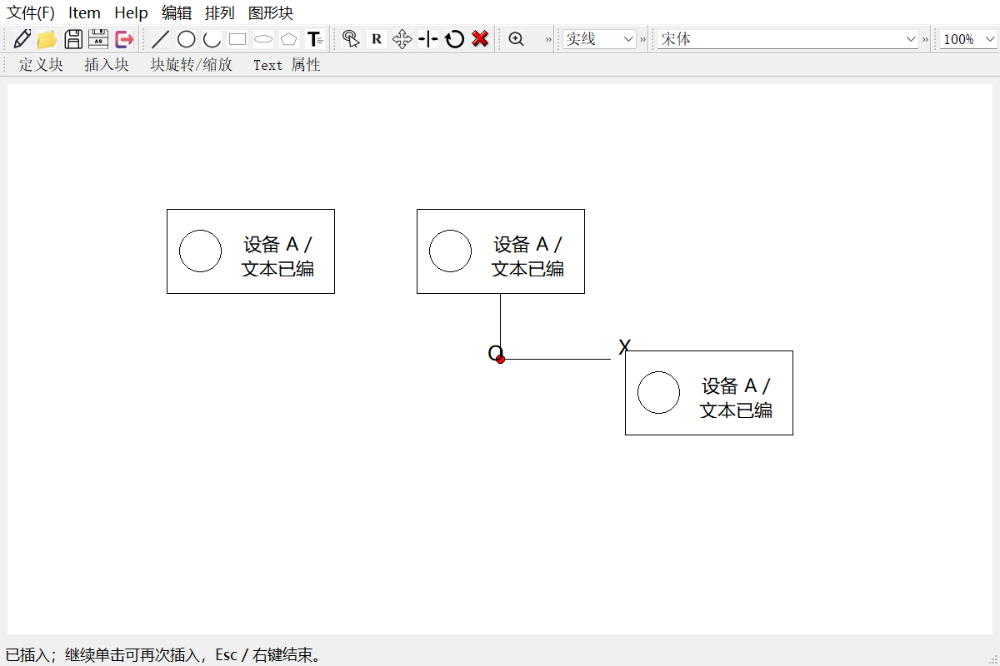

# QCAD_more

基于课程 QCAD 的 C++/Qt 图形学作业，实现“图形块操作：定义与插入”。已完成复合图形选择、块定义、Text 属性编辑、鼠标定位插入、文档保存与重新打开。



## 运行

本机已配置好独立环境并完成 Release 编译，双击仓库根目录的 **Start-QCAD.cmd** 即可启动。也可以在项目目录运行：

```powershell
powershell -NoProfile -ExecutionPolicy Bypass -File scripts/run.ps1
```

程序位于 `build/cmake/Release/QCAD_more.exe`，启动脚本为该进程设置 Qt DLL 和插件路径；不要把 exe 单独复制出去运行。

## 作业操作步骤

1. 使用原绘图工具栏绘制直线、矩形、圆、椭圆、圆弧、多边形或 Text。普通图形依次单击指定点；圆弧为圆心、起点、终点；多边形双击结束；Text 指定两个文本框角点后输入内容。
2. 按 Esc 切换到选择状态，拖框完全包围多个图元；Shift 单击/拖框可追加，Ctrl+A 可全选。
3. 点击 **定义块**，输入唯一块名，再在画布上单击基点。原图形保留，块定义保存独立快照；选择集可以包含已有块实例，形成嵌套块。
4. 选中单个 Text 后可以双击直接打开编辑窗口，也可以点击 **Text 属性** 或 Ctrl+E；编辑内容、本机全部字体、字号、字形、颜色及文本框位置和尺寸。字号支持小数和较大值，确认后应用，取消不修改。
5. 点击 **插入块**，选择定义，再设置旋转角度和等比缩放，移动鼠标预览，单击插入。可连续插入多个实例，Esc/右键结束。选中已插入的块后，点击 **块旋转/缩放** 可调整变换。
   选中一个块后点击 **Text 属性**，按层级路径选择内部文字进行编辑；仅当前实例改变，其他实例及块定义保持原样。文本框位置使用变换前坐标。
6. 在 **文件 → 保存/另存文件** 中保存为 `.qbl`；重新打开后，图形、文本属性、块定义和实例位置均会恢复，仍能继续插入已有块。

按 Esc 返回选择状态后，普通图元和块都能按住左键直接拖动；已选图形内部可起手，多选时一起移动，松开提交。空白处拖动仍为框选，Shift 保留选择操作，Esc/右键/切换工具取消。滚轮以鼠标位置为中心缩放，中键按住平移画布，右上角百分比可选择或输入。

新增 **编辑** / **排列** 菜单，提供复制、剪切、粘贴、快速复制、撤销重做、组合/取消组合、旋转、等比缩放、翻转、六种对齐、等距分布及置顶置底。方向键微移，Shift+方向键移动十倍距离。已有颜色、填充、线宽、线型和字体工具也能修改当前选择集。详见 [常用图形编辑](docs/usage.md#常用图形编辑)。

可用 **文件 → 打开文件** 打开 [示例文档](examples/block-demo.qbl)，其中包含一个复合块定义、原始图元和两个插入实例。完整说明见 [使用指南](docs/usage.md)。

## 开发环境与构建

使用 Visual Studio 2022 C++ 工具链、CMake、Qt 5.15.2 和 C++14。Qt SDK 与辅助 Python 环境都在项目 `build/` 下，**不依赖 lerobot，不向其安装包**。

新机器需先安装 Visual Studio C++/CMake 和 Conda，再执行：

```powershell
# Conda 已在 PATH 时可省略 -CondaExe；本机路径如下。
powershell -NoProfile -ExecutionPolicy Bypass -File scripts/setup-qt.ps1 -CondaExe D:\conda\Scripts\conda.exe
powershell -NoProfile -ExecutionPolicy Bypass -File scripts/build.ps1 -Check
```

普通开发使用 `scripts/build.ps1`；只有需要验证业务改动时加 `-Check`。`setup-qt.ps1` 在 `build/qt-dev` 创建独立 Python 3.11 环境，以 aqtinstall 3.3.0 下载 Qt 5.15.2 基础开发包。辅助脚本不参与产品运行。

完成作业后，先关闭 QCAD，把需要保留的 `.qbl` 文件移到 `build/` 之外，然后删除整个 `build/` 即可移除项目 Qt SDK、独立工具环境和编译产物。若希望同步移除 Conda 环境登记，可先运行：

```powershell
D:\conda\Scripts\conda.exe env remove --prefix .\build\qt-dev --yes
```

源码、开发文档和 `examples/` 不受影响；系统已有 Visual Studio/CMake 和 Conda 本身不在本项目清理范围。

## 结构与维护

```text
src/
├── qcad/          # 引入并修复的课程图元、视图与窗口
├── selection/     # 点选、拖框、Shift 追加选择
├── blocks/        # 块定义、实体与插入
├── text/          # 文本属性服务与对话框
├── storage/       # 图元编解码、文档保存/读取
├── integration/   # 菜单协调及绘图/选点命令
└── common/        # 操作结果
scripts/            # 独立环境安装、构建、运行
tests/              # 核心业务与窗口流程验证
examples/           # 可直接打开的演示文档
docs/               # 使用、设计、来源和每次开发记录
```

开发前阅读 [AGENTS.md](AGENTS.md)。每次修改填写开发记录；模块契约及格式见 [设计说明](docs/architecture/block-operations.md)，来源见 [课程源码记录](docs/provenance/README.md)。

## 验证与范围

执行 `scripts/build.ps1 -Check` 同时运行原块操作和新增编辑操作的离屏及 Windows 原生测试。测试覆盖全部绘图工具、七类图元拖动/复制/完整往返、滚轮锚点和中键平移、剪贴板/快捷键、撤销重做、对齐分布、组合拆分、图层样式、嵌套块与 Text 编辑、旧版文件读取和损坏文件保护。完整日志保存在 docs/presentation。

支持嵌套块、实例文字编辑、普通图形与块的旋转/等比缩放/翻转。采用独立快照，修改实例不会回写定义。嵌套最多 32 层，撤销最多 100 次编辑；视图比例 1%–10000%。保存为 `.qbl` v3，兼容读取 v1/v2；旧版程序不能读取 v3。剪贴板使用本程序的图元格式，不直接粘贴到 PowerPoint。不支持非等比缩放、DWG/DXF 或原课程 `.cad` 格式。
